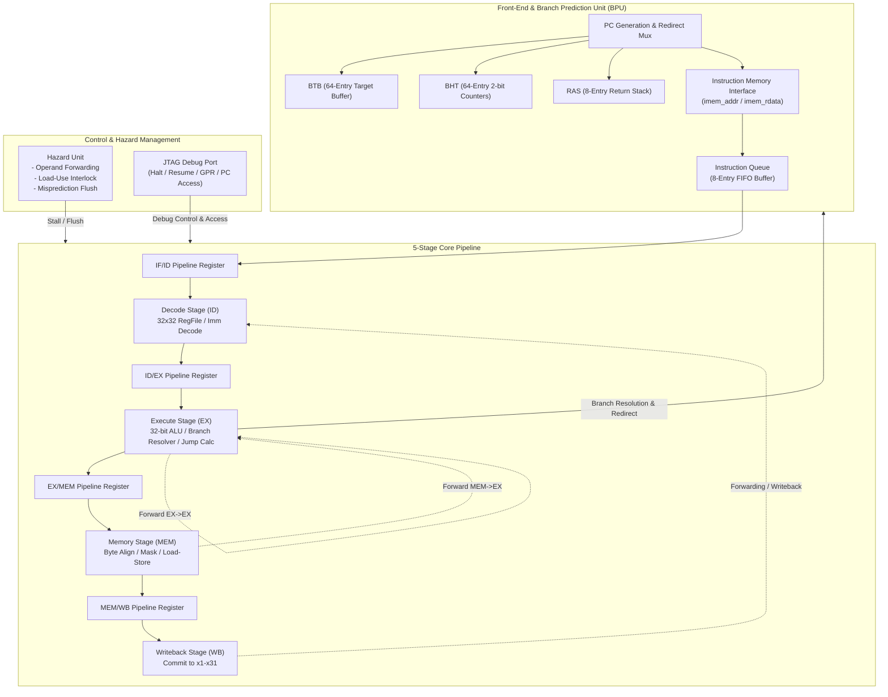

# AZ-V32M 32-Bit RISC-V Processor Core

[English](README.md) | [繁體中文](README_zh.md)

---

## Key Features

* **ISA Compliance**: Fully conforms to the RISC-V Unprivileged ISA Specification (RV32I Base Integer Instruction Set).
* **Classic 5-Stage In-Order Pipeline**:
  * **IF (Instruction Fetch)**: Generates fetch PC, integrates speculative branch target lookup, and pushes instructions to the queue.
  * **ID (Instruction Decode)**: 32 x 32-bit General-Purpose Register File (x0 hardwired to zero), immediate decoding (I, S, B, U, J types), and hazard detection.
  * **EX (Execute)**: Single-cycle 32-bit ALU, branch condition resolver, jump target calculation, and operand forwarding multiplexers.
  * **MEM (Memory Access)**: Byte/Halfword/Word loads and stores with sign/zero extension (LB, LH, LW, LBU, LHU, SB, SH, SW).
  * **WB (Writeback)**: Selects between ALU result, memory load data, and return PC+4 to commit into architectural registers.
* **Advanced Front-End Speculative Branch Prediction Unit (BPU)**:
  * **BTB (Branch Target Buffer)**: 64-entry direct-mapped cache providing single-cycle target address prediction.
  * **BHT (Branch History Table)**: 64-entry array of 2-bit saturating counters (Strongly/Weakly Taken/Not-Taken) for dynamic branch direction prediction.
  * **RAS (Return Address Stack)**: 8-entry hardware LIFO stack for accurate prediction of function call returns (`ret` / `jalr`).
  * **Instruction Queue (IQ)**: 8-entry FIFO fetch buffer that decouples the speculative front-end from execution stages, smoothing memory latency and pipeline stalls.
* **Robust Hazard Management**:
  * **Comprehensive Data Forwarding**: EX-to-EX and MEM-to-EX forwarding networks eliminate RAW data dependency stalls whenever possible.
  * **Load-Use Interlocking**: Hardware detects load-use hazards and automatically inserts a 1-cycle pipeline bubble (`stall_if`, `stall_id`, `flush_ex`).
  * **Fast Misprediction Recovery**: Automatic 2-cycle pipeline flush and immediate Fetch Unit redirection upon branch misprediction in the EX stage.
* **Hardware Debug & JTAG Interface (DMI Ready)**:
  * Non-intrusive CPU pipeline halt and resume controls (`debug_halt_req`, `debug_resume_req`, `debug_halted`).
  * Direct read and write access to general-purpose registers (`x0`–`x31`) and program counter (`PC`) for external JTAG Debug Modules (DM).
* **Flexible Memory Interfaces**:
  * Harvard architecture with separate instruction and data memory buses, easily interfacing to single-cycle SRAM, dual-port Block RAM (BRAM), or AXI4-Lite interconnects.

---

## Architecture Overview



---

## Repository Structure

```text
AZ-V32M/
├── rtl/                        # SystemVerilog RTL source files
│   ├── pkg/
│   │   └── riscv_pkg.sv        # Package with ISA constants, opcodes, and pipeline structs
│   ├── frontend/
│   │   ├── fetch_unit.sv       # Instruction fetch top (PC logic, BTB, BHT, RAS)
│   │   ├── btb.sv              # Branch Target Buffer (direct-mapped cache)
│   │   ├── bht.sv              # Branch History Table (2-bit saturating counters)
│   │   ├── ras.sv              # Return Address Stack (LIFO)
│   │   └── instr_queue.sv      # 8-entry Instruction Queue FIFO
│   ├── core/
│   │   ├── regfile.sv          # 32x32-bit register file with JTAG debug read/write port
│   │   ├── decode_stage.sv     # Instruction decode and control generation
│   │   ├── alu.sv              # 32-bit arithmetic and logic unit
│   │   ├── execute_stage.sv    # Execution stage (ALU, branch resolution, target evaluation)
│   │   ├── memory_stage.sv     # Memory interface stage (byte enable generation and sign extension)
│   │   └── writeback_stage.sv  # Commit and writeback multiplexing
│   ├── pipeline/
│   │   └── hazard_unit.sv      # Hazard detection, forwarding network, and stall/flush logic
│   └── top/
│       └── az_v_core_top.sv    # Top-level processor core module
├── sw/                         # Bare-metal C software framework and examples
│   ├── common/
│   │   ├── crt0.s              # Startup assembly code (GPR zeroing, stack setup)
│   │   ├── link.ld             # Linker script for 64 KB unified RAM space
│   │   ├── az_v.h              # Hardware helper headers and MMIO addresses
│   │   └── az_v.c              # Basic runtime routines (putchar, print_str, print_hex)
│   ├── examples/               # Bare-metal C benchmarks
│   │   ├── hello.c             # Hello World output test
│   │   ├── fibonacci.c         # Fibonacci sequence calculation
│   │   ├── bubble_sort.c       # In-place bubble sort algorithm
│   │   └── matrix_mul.c        # 2D matrix multiplication benchmark
│   ├── tools/
│   │   └── elf2hex.py          # ELF / binary to simulation memory hex converter
│   └── Makefile                # Software compilation script
├── tb/                         # Testbench and verification environment
│   ├── az_v_tb.sv              # SystemVerilog top testbench connecting core to RAM model
│   ├── ram_model.sv            # 64 KB dual-port memory simulation model
│   ├── tb_top.cpp              # Verilator C++ automated self-checking driver and profiler
│   └── hex/                    # Precompiled verification hex images
│       ├── basic_test.hex
│       ├── rv32i_alu_logic.hex
│       ├── rv32i_mem_loadstore.hex
│       ├── rv32i_branch_jump.hex
│       ├── bpu_loop_test.hex
│       └── bpu_ras_call_ret.hex
├── Makefile                    # Top-level build, simulation, and regression Makefile
├── README.md                   # English documentation (Homepage, this file)
└── README_zh.md                # Traditional Chinese documentation
```

---

## Interface Specification

The top-level core module `az_v_core_top` provides standard, low-latency interfaces:

| Signal Name | Direction | Width | Description |
| :--- | :---: | :---: | :--- |
| **System Interface** | | | |
| `clk` | Input | 1 | Primary system clock (positive edge triggered) |
| `rst_n` | Input | 1 | Asynchronous global reset (active low) |
| **Instruction Memory (IMEM)** | | | |
| `imem_addr` | Output | 32 | Instruction fetch address (4-byte aligned) |
| `imem_rdata` | Input | 32 | Fetched instruction data (single-cycle latency) |
| **Data Memory (DMEM)** | | | |
| `dmem_addr` | Output | 32 | Data access physical address |
| `dmem_wdata` | Output | 32 | Write data bus |
| `dmem_byte_enable` | Output | 4 | Byte enable mask for byte/halfword/word store operations |
| `dmem_req` | Output | 1 | Memory access request strobe (valid for load or store) |
| `dmem_we` | Output | 1 | Write enable (1: Store, 0: Load) |
| `dmem_rdata` | Input | 32 | Read data bus returned from memory |
| **Hardware Debug Interface** | | | |
| `debug_halt_req` | Input | 1 | Halt execution request from external Debug Module |
| `debug_resume_req` | Input | 1 | Resume execution request from external Debug Module |
| `debug_halted` | Output | 1 | Status flag indicating core is currently halted |
| `debug_gpr_addr` | Input | 5 | GPR index to access (`x0` to `x31`) |
| `debug_gpr_rdata` | Output | 32 | Current data from the addressed GPR |
| `debug_gpr_wdata` | Input | 32 | Write data to be committed to the selected GPR |
| `debug_gpr_wen` | Input | 1 | Write enable strobe for GPR debug access |
| `debug_pc_wdata` | Input | 32 | New PC value forced during debug mode |
| `debug_pc_wen` | Input | 1 | Write enable strobe for PC debug register |
| `debug_pc_rdata` | Output | 32 | Current program counter value |

---

## Simulation and Verification

The test environment uses **Verilator** for cycle-accurate C++ simulation. It includes automated self-checking golden register validation and dynamic branch predictor profiling.

### 1. Prerequisites
* `verilator` (>= 4.038)
* `g++` (C++14 / C++17 compatible)
* `make`
* `python3`
* `riscv64-unknown-elf-gcc` or `riscv32-unknown-elf-gcc` (optional, for compiling bare-metal C programs)

### 2. Linting RTL Sources
```bash
make lint
```

### 3. Building Simulation Executable
```bash
make build
```
This compiles the SystemVerilog RTL and the C++ testbench driver [`tb/tb_top.cpp`](tb/tb_top.cpp) into `./obj_dir/Vaz_v_tb`.

### 4. Running Hardware Regression Suite
```bash
make test_all
```
This runs the automated suite covering all basic processor subsystems:
1. `basic_test`: Fundamental arithmetic and register movement.
2. `rv32i_alu_logic`: Exhaustive testing of all 10 ALU functional operations.
3. `rv32i_mem_loadstore`: Verification of signed/unsigned byte, halfword, and word memory operations.
4. `rv32i_branch_jump`: Branch comparisons (BEQ, BNE, BLT, BGE, BLTU, BGEU) and jump logic (JAL, JALR).
5. `bpu_loop_test`: Loop branch predictor training and 2-bit counter transitions.
6. `bpu_ras_call_ret`: Nested function calls and Return Address Stack (RAS) prediction.

### 5. Running Bare-Metal C Test Suite
```bash
make test_c_all
```
Compiles and simulates `hello`, `fibonacci`, `bubble_sort`, and `matrix_mul` C benchmarks.

### 6. Example Output & Profiler Report
Upon completion, the C++ driver reports golden register checks and detailed front-end BPU statistics:
```text
==========================================
 Running Suite: bpu_loop_test
 Hex Image:    tb/hex/bpu_loop_test.hex
==========================================

------------------------------------------
        AZ_V Register File Dump          
------------------------------------------
x01 = 0x00000005 (5)
x02 = 0x00000005 (5)
x03 = 0x00000032 (50)

------------------------------------------
  Front-End BPU & Performance Statistics 
------------------------------------------
Total Execution Cycles : 82
Total Resolved Branches: 10
Branch Hits (Correct)  : 9
Branch Mispredictions  : 1
Branch Hit Accuracy    : 90.0 %
Pipeline Flush Cycles  : 1
==========================================
 TEST RESULT: [ PASSED ]
==========================================
```
A waveform dump (`sim_wave.vcd`) is generated in the root directory and can be analyzed using GTKWave or Surfer.

---

## Bare-Metal Software Development

The `sw/` directory provides a lightweight environment for compiling C code to run directly on AZ-V32M:

### Compiling Programs:
```bash
cd sw
make all
```
* Compiles source files using the linker script [`link.ld`](sw/common/link.ld).
* Invokes [`tools/elf2hex.py`](sw/tools/elf2hex.py) to format the output into `.hex` files suitable for Verilator simulation and FPGA Block RAM preloading.
* Generated artifacts are stored in `sw/build/` (`.elf`, `.dis`, `.bin`, `.hex`).

---

## License

This project is released under an open-source license. You are welcome to use, modify, and integrate this processor core in academic research, prototyping, and commercial silicon designs. See the root license file for complete details.
