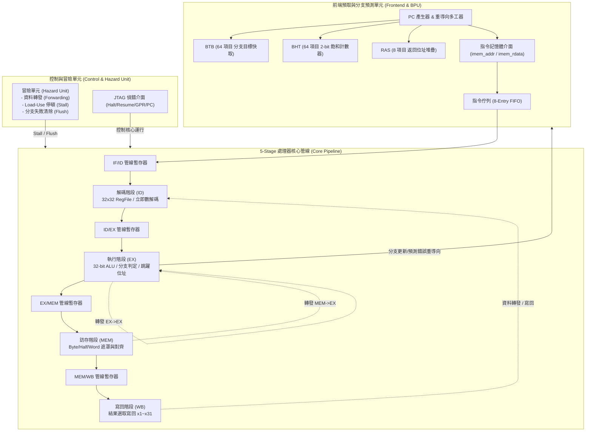

# AZ-V32M RISC-V 32-Bit 處理器核心

[English](README.md) | [繁體中文](README_zh.md)

**AZ-V32M**（亦稱 **AZ_V**）是一款採用 SystemVerilog 撰寫的高效能、可客製化 32 位元 RISC-V 處理器核心。核心完全實現 **RV32I 基本整數指令集**，具備經典 **5-Stage 管線架構**，並整合進階**前端投機分支預測單元 (BPU)** 與 **指令佇列 (Instruction Queue)**。

---

## 核心主要特性 (Key Features)

* **標準相容**：完整相容 RISC-V Unprivileged ISA Specification (RV32I Base Integer Instruction Set)。
* **5-Stage 經典管線**：
  * **IF (Instruction Fetch)**：整合預測目標產生與 PC 更新邏輯。
  * **ID (Instruction Decode)**：32 顆 32-bit 通用暫存器檔案 (GPR, x0 硬體接地為 0)、立即數解碼與冒險偵測。
  * **EX (Execute)**：32-bit 高效能 ALU、分支條件評估、Jump 位址計算及全功能資料轉發多工器。
  * **MEM (Memory Access)**：支援 Byte / Halfword / Word 存取與符號擴展 (LB, LH, LW, LBU, LHU, SB, SH, SW)。
  * **WB (Writeback)**：ALU 結果、記憶體讀取資料與 Jump 鏈接位址 (PC+4) 寫回暫存器。
* **進階前端投機預測單元 (BPU)**：
  * **BTB (Branch Target Buffer)**：64-Entry 直接映射快取，單週期提供分支預測目標位址。
  * **BHT (Branch History Table)**：64-Entry 2-bit 飽和計數器 (Strongly/Weakly Taken/Not-Taken) 動態學習分支方向。
  * **RAS (Return Address Stack)**：8-Entry 硬體 LIFO 呼叫/返回堆疊，精確預測函式返回位址 (`ret` / `jalr`)。
  * **Instruction Queue (IQ)**：8-Entry 預取指令緩衝佇列，有效解耦前端取指與後端解碼執行，平滑記憶體等待延遲。
* **完整的冒險處理機制 (Hazard Handling)**：
  * **全資料前轉 (Data Forwarding)**：支援 EX ➔ EX 與 MEM ➔ EX 轉發，消除大部分資料相依性延遲。
  * **Load-Use 冒險停頓**：硬體自動偵測 Load-Use 相依性並插入 1 拍管線停頓 (Stall)。
  * **分支預測失敗快速復原**：在 EX 階段偵測預測錯誤時，自動觸發 2-Cycle 管線清除 (Flush) 並重導向正確路徑。
* **原生 JTAG 偵錯介面 (Hardware Debug Ready)**：
  * 提供非侵入式處理器暫停 (Halt) 與繼續 (Resume) 控制。
  * 支援直接由偵錯模組 (DM) 讀寫通用暫存器 (GPR x0~x31) 與程式計數器 (PC)。
* **靈活的記憶體匯流排介面**：
  * 獨立哈佛結構 (Harvard Architecture) 指令與資料介面，可無縫對接單週期 SRAM、雙埠 Block RAM 或 AXI4-Lite 匯流排橋接器。

---

## 處理器架構圖 (Architecture Overview)



---

## 模組目錄結構 (Repository Structure)

```text
AZ-V32M/
├── rtl/                        # SystemVerilog 硬體原始碼
│   ├── pkg/
│   │   └── riscv_pkg.sv        # 架構常數、指令操作碼 (Opcode)、管線結構體封裝
│   ├── frontend/
│   │   ├── fetch_unit.sv       # 取指單元頂層 (整合 PC 控制、BTB、BHT、RAS)
│   │   ├── btb.sv              # 分支目標快取 (Branch Target Buffer)
│   │   ├── bht.sv              # 分支歷程表 (Branch History Table, 2-bit 飽和計數器)
│   │   ├── ras.sv              # 返回位址堆疊 (Return Address Stack)
│   │   └── instr_queue.sv      # 8 項目指令佇列 (FIFO Buffer)
│   ├── core/
│   │   ├── regfile.sv          # 32 顆 32-bit 通用暫存器檔案 (含 JTAG 偵錯存取埠)
│   │   ├── decode_stage.sv     # 指令解碼階段
│   │   ├── alu.sv              # 32 位元算術邏輯單元 (ALU)
│   │   ├── execute_stage.sv    # 執行階段頂層 (含分支解析與目標計算)
│   │   ├── memory_stage.sv     # 訪存階段 (Byte-Enable 產生與讀取對齊)
│   │   └── writeback_stage.sv  # 寫回階段
│   ├── pipeline/
│   │   └── hazard_unit.sv      # 冒險偵測與前轉控制單元 (Forwarding & Stall/Flush)
│   └── top/
│       └── az_v_core_top.sv    # CPU 核心頂層整合模組
├── sw/                         # 裸機 (Bare-Metal) C 軟體生態與範例
│   ├── common/
│   │   ├── crt0.s              # 啟動代碼 (暫存器歸零、設定 Stack Pointer)
│   │   ├── link.ld             # 鏈結腳本 (64 KB 記憶體空間佈局)
│   │   ├── az_v.h              # 軟體輔助函式庫與 MMIO 定義
│   │   └── az_v.c              # print_str, print_hex, putchar 實作
│   ├── examples/               # C 語言基準測試範例
│   │   ├── hello.c             # Hello World 字串輸出
│   │   ├── fibonacci.c         # 費氏數列計算
│   │   ├── bubble_sort.c       # 氣泡排序法
│   │   └── matrix_mul.c        # 矩陣相乘運算
│   ├── tools/
│   │   └── elf2hex.py          # ELF / 二進制轉 FPGA/模擬 HEX 工具
│   └── Makefile                # 軟體編譯自動化腳本
├── tb/                         # 驗證測試平台 (Testbench)
│   ├── az_v_tb.sv              # SystemVerilog 模擬頂層 (連接 CPU 與記憶體模型)
│   ├── ram_model.sv            # 64KB 雙埠記憶體模擬模型
│   ├── tb_top.cpp              # Verilator C++ 自動自檢驅動程式 (Self-Checking Driver)
│   └── hex/                    # 預先編譯好的硬體驗證 HEX 測試向量
│       ├── basic_test.hex
│       ├── rv32i_alu_logic.hex
│       ├── rv32i_mem_loadstore.hex
│       ├── rv32i_branch_jump.hex
│       ├── bpu_loop_test.hex
│       └── bpu_ras_call_ret.hex
├── Makefile                    # 頂層建置、模擬與驗證 Makefile
├── README.md                   # 英文說明文件 (首頁)
└── README_zh.md                # 繁體中文說明文件 (本文件)
```

---

## 核心介面規格 (Interface Specification)

`az_v_core_top` 提供標準化的信號介面：

| 訊號名稱 | 方向 | 寬度 | 說明 |
| :--- | :---: | :---: | :--- |
| **系統介面** | | | |
| `clk` | Input | 1 | 系統主要時脈 (正緣觸發) |
| `rst_n` | Input | 1 | 非同步主重置訊號 (低電位有效) |
| **指令記憶體 (IMEM)** | | | |
| `imem_addr` | Output | 32 | 取指實體位址 (對齊 4-Byte) |
| `imem_rdata` | Input | 32 | 指令讀取資料 (單週期回應) |
| **資料記憶體 (DMEM)** | | | |
| `dmem_addr` | Output | 32 | 資料存取實體位址 |
| `dmem_wdata` | Output | 32 | 資料寫入資料 |
| `dmem_byte_enable` | Output | 4 | 位元組致能遮罩 (對應 4 個 Byte，支援 SB/SH/SW) |
| `dmem_req` | Output | 1 | 記憶體請求有效訊號 (Read 或 Write) |
| `dmem_we` | Output | 1 | 寫入致能訊號 (1: Store, 0: Load) |
| `dmem_rdata` | Input | 32 | 資料讀取資料 |
| **JTAG 偵錯介面** | | | |
| `debug_halt_req` | Input | 1 | 請求 CPU 暫停管線運行 |
| `debug_resume_req` | Input | 1 | 請求 CPU 恢復管線運行 |
| `debug_halted` | Output | 1 | CPU 目前處於暫停狀態指示 |
| `debug_gpr_addr` | Input | 5 | 欲存取的通用暫存器編號 (`x0` ~ `x31`) |
| `debug_gpr_rdata` | Output | 32 | 通用暫存器目前數值輸出 |
| `debug_gpr_wdata` | Input | 32 | 寫入通用暫存器之數值 |
| `debug_gpr_wen` | Input | 1 | 偵錯通用暫存器寫入致能 |
| `debug_pc_wdata` | Input | 32 | 強制寫入 PC 之數值 |
| `debug_pc_wen` | Input | 1 | 偵錯 PC 寫入致能 |
| `debug_pc_rdata` | Output | 32 | 目前 PC 數值輸出 |

---

## 模擬與驗證 (Simulation & Verification)

本核心採用 **Verilator** 進行週期精確 (Cycle-Accurate) 的 C++ 高速模擬，並內建完整的自檢金牌暫存器 (Golden Register Check) 與 BPU 效能統計分析器。

### 1. 環境需求
* `verilator` (>= 4.038)
* `g++` (支援 C++14 / C++17)
* `make`
* `python3`
* `riscv64-unknown-elf-gcc` 或 `riscv32-unknown-elf-gcc`（可選，編譯 C 軟體所需）

### 2. 執行語法檢查 (Lint)
```bash
make lint
```

### 3. 編譯模擬執行檔
```bash
make build
```
該命令會調用 Verilator 將 SystemVerilog RTL 與 C++ 測試驅動模組 [`tb/tb_top.cpp`](tb/tb_top.cpp) 編譯為 `./obj_dir/Vaz_v_tb`。

### 4. 執行硬體單元回歸測試 (Test All)
```bash
make test_all
```
自動依序執行六大硬體指令集與架構自檢測試：
1. `basic_test`：基礎 ALU 與資料傳遞。
2. `rv32i_alu_logic`：全 10 種 ALU 運算邏輯驗證。
3. `rv32i_mem_loadstore`：Byte / Halfword / Word 存取、符號與無符號擴展。
4. `rv32i_branch_jump`：條件分支（BEQ, BNE, BLT, BGE 等）與 JAL / JALR 跳躍。
5. `bpu_loop_test`：迴圈分支預測與 BHT 飽和計數器狀態轉移驗證。
6. `bpu_ras_call_ret`：多層巢狀函式呼叫與 RAS 返回堆疊預測驗證。

### 5. 執行裸機 C 語言測試集 (Test C All)
```bash
make test_c_all
```
自動編譯並運行 `hello`、`fibonacci`、`bubble_sort` 與 `matrix_mul` 基準測試程式。

### 6. 模擬輸出與 BPU 效能分析範例
模擬完成後，C++ 驅動程式會輸出暫存器狀態傾印 (Register Dump) 以及分支預測統計報表：
```text
==========================================
 Running Suite: bpu_loop_test
 Hex Image:    tb/hex/bpu_loop_test.hex
==========================================

------------------------------------------
        AZ_V Register File Dump          
------------------------------------------
x01 = 0x00000005 (5)
x02 = 0x00000005 (5)
x03 = 0x00000032 (50)

------------------------------------------
  Front-End BPU & Performance Statistics 
------------------------------------------
Total Execution Cycles : 82
Total Resolved Branches: 10
Branch Hits (Correct)  : 9
Branch Mispredictions  : 1
Branch Hit Accuracy    : 90.0 %
Pipeline Flush Cycles  : 1
==========================================
 TEST RESULT: [ PASSED ]
==========================================
```

同時會在當前目錄生成波形檔 `sim_wave.vcd`，可使用 GTKWave 或 Surfer 開啟檢視。

---

## 軟體開發流程 (Bare-Metal Software Development)

本專案支援標準 GCC 工具鏈編譯裸機程式。

### 編譯自訂 C 程式：
```bash
cd sw
make all
```
* 編譯流程會自動使用 [`link.ld`](sw/common/link.ld) 安排記憶體配置，並調用 [`tools/elf2hex.py`](sw/tools/elf2hex.py) 產出供模擬與 FPGA 預載使用的 `.hex` 檔案。
* 輸出目錄位於 `sw/build/`，包含 `.elf`、`.dis`（反組譯清單）、`.bin` 與 `.hex`。

---

## 授權條款 (License)

本專案基於開源授權發布，歡迎於學術研究、商業評估與晶片開發中引用及客製化。詳細條款請參閱根目錄授權文件。

